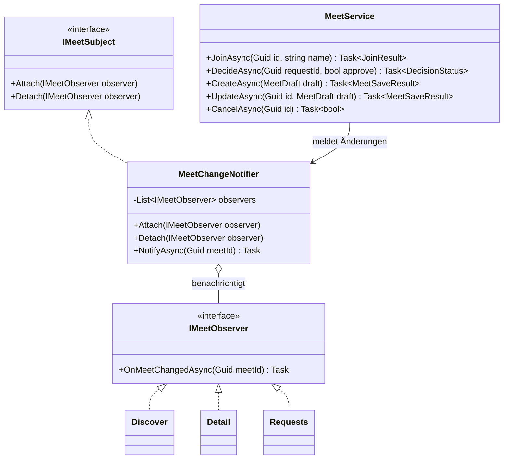
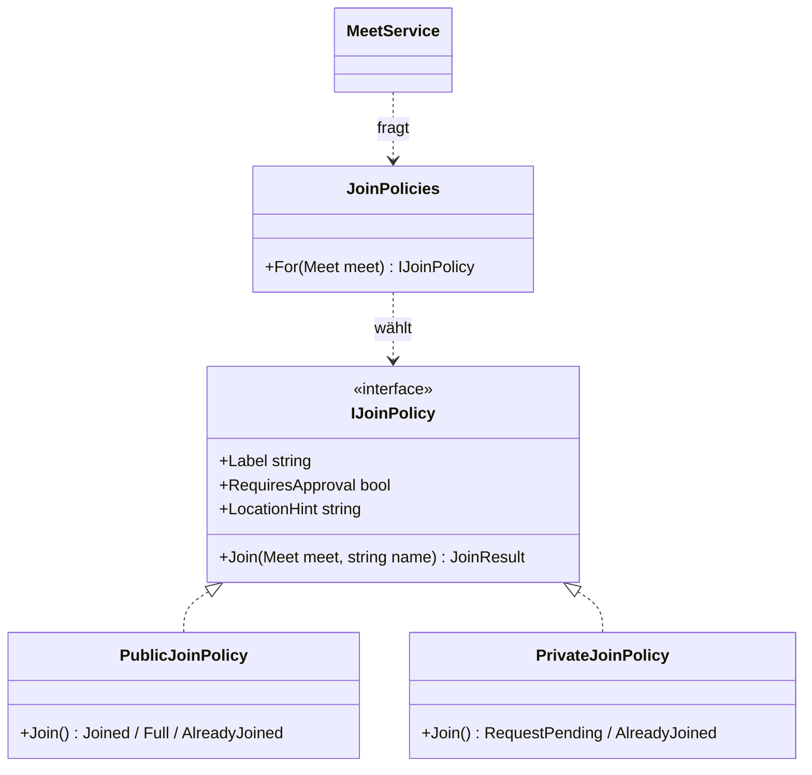
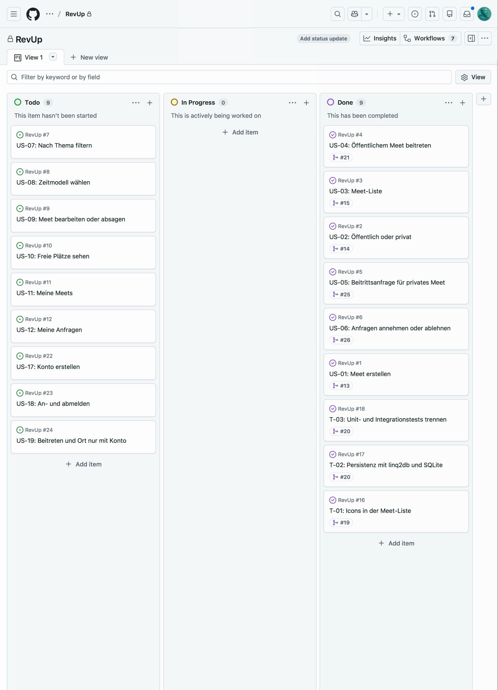

# Lösungsdokument LB 426: RevUp

*Dokument 12 von 12 · [← 11 Prototyp-Test](UX/11-PROTOTYP-TEST.md) · [↑ Start](../README.md)*

| | |
|---|---|
| Name | Nicolas Stadelmann |
| Modul | 426 «Software mit agilen Methoden entwickeln» |
| Projekt | RevUp, Web-App zur Organisation von Car- und Bike-Meets (eigene Idee, Einzelarbeit, von der Lehrperson freigegeben) |
| Repository | https://github.com/Tojioo/RevUp (privat, Lehrperson hat Zugriff) |
| Board | https://github.com/users/Tojioo/projects/2/views/1 |
| Abgabe | Ordner und ZIP `StadelmannLB-426` |

## 0 Administratives (Aufgabe 0-1)

- Einzelarbeit statt Partnerarbeit und GitHub statt GitLab der BBB sind mit der Lehrperson abgesprochen. Die Bewertung erfolgt wie bei einem Teamprojekt.
- Programmiersprache C# (.NET 10, ASP.NET Core Blazor), Tests mit xUnit, CI mit GitHub Actions.
- Gemergt wird nur mit Merge Commits; Squash und Rebase sind im Repository ausgeschaltet, Quellbranches werden nicht gelöscht. So bleiben die Test-Commits jeder Story sichtbar (entspricht der GitLab-Vorgabe «Delete source branch» aus).
- Alle schriftlichen Ergebnisse stehen in diesem Dokument; die übrigen Dokumente unter `Docs/` sind verlinkt.

## 1 User Stories (Aufgaben 1-1, 1-2)

Alle Stories folgen dem Muster «Als \<Rolle> möchte ich \<Ziel>, damit \<Nutzen>», haben eine eindeutige ID (`US-xx`) und prüfbare Akzeptanzkriterien. Der vollständige Product Backlog mit Akzeptanzkriterien steht in [01-BACKLOG.md](01-BACKLOG.md), jede Story ist zusätzlich ein GitHub-Issue.

| ID    | User Story (Kurzform)                                                              | Status        |
|-------|------------------------------------------------------------------------------------|---------------|
| US-01 | Als Veranstalter möchte ich ein Meet erstellen, damit ich einen Treffpunkt organisieren kann. | umgesetzt |
| US-02 | Als Veranstalter möchte ich ein Meet als öffentlich oder privat markieren, damit ich steuern kann, wer den Standort sieht. | umgesetzt |
| US-03 | Als Teilnehmer möchte ich alle aktuellen Meets in einer Liste sehen, damit ich ein passendes Meet finden kann. | umgesetzt |
| US-04 | Als Teilnehmer möchte ich einem öffentlichen Meet mit meinem Namen beitreten und danach den Standort sehen, damit ich hinfahren kann. | umgesetzt |
| US-05 | Als Teilnehmer möchte ich bei einem privaten Meet eine Beitrittsanfrage stellen, damit der Veranstalter über meine Teilnahme entscheiden kann. | umgesetzt |
| US-06 | Als Veranstalter möchte ich offene Anfragen annehmen oder ablehnen, damit ich die Kontrolle über die Teilnehmerliste behalte. | umgesetzt |
| US-07 | Als Teilnehmer möchte ich Meets nach Thema filtern, damit ich schneller passende Meets finde. | umgesetzt |
| US-08 | Als Veranstalter möchte ich ein Zeitmodell wählen (Fixed / Open Start / Open End), damit klar ist, wann das Meet stattfindet. | umgesetzt |
| US-09 | Als Veranstalter möchte ich mein Meet bearbeiten oder absagen, damit ich auf Änderungen reagieren kann. | umgesetzt |
| US-10 | Als Teilnehmer möchte ich sehen, wie viele Plätze noch frei sind, damit ich weiss, ob sich eine Anfrage lohnt. | umgesetzt |
| US-11, US-12, US-17 – US-19 | «Meine Meets», «Meine Anfragen», Konten | bewusst nach der LB (siehe Retrospektive) |

Zusätzlich gab es drei technische Aufgaben ohne neue Funktion für Nutzer: T-01 (Icons), T-02 (Persistenz mit linq2db und SQLite), T-03 (Trennung von Unit- und Integrationstests).

## 2 Design Patterns (Aufgabe 2-1)

### 2.1 Observer (vorgegeben)

**Problem:** Mehrere Personen haben dieselben Daten gleichzeitig offen. Der Veranstalter wartet auf der Seite «Anfragen» auf neue Anfragen, die anfragende Person auf der Detailseite auf den Entscheid, und in «Entdecken» sollen die freien Plätze stimmen (US-10: «live aktualisiert»). Ohne Pattern müsste der `MeetService` jede Seite kennen, oder jede Seite müsste ständig neu laden.

**Lösung:** Der `MeetService` meldet jede Änderung an einem Meet einem Subjekt. Seiten, die sich dafür interessieren, melden sich als Beobachter an und laden sich bei einer Meldung neu. Sender und Empfänger kennen sich nicht.

| Rolle im Pattern     | Klasse im Code                                                |
|----------------------|---------------------------------------------------------------|
| Subjekt (Interface)  | `IMeetSubject` mit `Attach` und `Detach`                      |
| Konkretes Subjekt    | `MeetChangeNotifier`, zusätzlich `NotifyAsync(meetId)`         |
| Beobachter           | `IMeetObserver` mit `OnMeetChangedAsync(meetId)`              |
| Konkrete Beobachter  | Seiten `Discover`, `Detail` und `Requests` (Blazor-Komponenten) |
| Auslöser             | `MeetService` nach Erstellen, Bearbeiten, Absagen, Beitritt, neuer Anfrage und Entscheid |

Details der Umsetzung:

- Jede Seite meldet sich in `OnInitializedAsync` an und in `Dispose` ab. So bekommt eine geschlossene Seite keine Meldungen mehr.
- `NotifyAsync` arbeitet auf einer Kopie der Beobachterliste, weil sich ein Beobachter während der Benachrichtigung abmelden kann.
- Der `MeetService` meldet erst, nachdem er seine Sperre freigegeben hat. Die Detailseite ruft bei einer Meldung den Service wieder auf (um zu sehen, ob ihre Anfrage angenommen wurde); innerhalb der Sperre würde das blockieren.
- Getestet in `MeetChangeNotifierTests` (anmelden, abmelden, doppelt anmelden, mehrere Beobachter) und `MeetDecisionTests` (jede Änderung wird gemeldet, ohne Änderung keine Meldung).

### 2.2 Strategy (zweites Pattern)

**Problem:** Öffentliche und private Meets unterscheiden sich darin, wie man beitritt und wann der Standort sichtbar wird: öffentlich sofort, privat erst nach Freigabe. Ohne Pattern stünden dieselben `if (meet.IsPublic)`-Abfragen in Liste, Detailseite und Service, und jede neue Regel (z. B. «nur auf Einladung») müsste an allen Stellen nachgezogen werden.

**Lösung:** Jede Sichtbarkeit ist eine eigene Strategie mit derselben Schnittstelle. Der Service fragt nur `JoinPolicies.For(meet)` nach der passenden Strategie und ruft sie auf; Liste und Detailseite holen Beschriftung und Ortshinweis ebenfalls von dort.

| Rolle im Pattern     | Klasse im Code                                   |
|----------------------|--------------------------------------------------|
| Strategie (Interface)| `IJoinPolicy` mit `Label`, `RequiresApproval`, `LocationHint`, `Join(meet, name)` |
| Konkrete Strategien  | `PublicJoinPolicy`, `PrivateJoinPolicy`          |
| Auswahl              | `JoinPolicies.For(meet)`                          |
| Kontext              | `MeetService.JoinAsync`, `MeetListItem`, `MeetDetails` |

Getestet in `JoinPolicyTests`: Beitritt bei öffentlichen Meets mit Ort, volles Meet, doppelter Name, privates Meet gibt den Ort nie heraus.

## 3 Umsetzung (Aufgaben 3-1 bis 3-7)

### 3.1 Aufteilung und eigener Branch (3-2)

Einzelarbeit: Alle Branches und Commits stammen von mir. Die Arbeit ist nach User Stories aufgeteilt, jede Story hat einen eigenen Branch, der per Pull Request in `main` gemergt wird. Die Lehrperson bewertet wie ein Teamprojekt.

### 3.2 Feature-Branches (3-3)

Jeder Branch enthält die ID der Story und wurde in `main` zurückgemergt.

| Branch | Story | Stichworte | Pull Request |
|---|---|---|---|
| `US-01-meet-erstellen` | US-01 | Formular «Neues Meet», serverseitige Validierung, Stepper | #13 |
| `US-02-sichtbarkeit` | US-02 | Umschalter öffentlich/privat, Strategy Teil 1 | #14 |
| `US-03-meet-liste` | US-03 | Liste kommender Meets ohne Standort, Zeitfenster auf Deutsch | #15 |
| `T-01-listen-icons` | T-01 | Icons für Zeit und Ort | #19 |
| `T-02-T-03-persistenz` | T-02, T-03 | SQLite mit linq2db, async Services, Integrationstests mit Snapshot | #20 |
| `US-04-oeffentlich-beitreten` | US-04 | Detailseite, Beitritt, Ort erst nach Beitritt, Strategy Teil 2 | #21 |
| `US-05-beitrittsanfrage` | US-05 | Anfragen speichern, Liste offener Anfragen | #25 |
| `US-06-anfragen-entscheiden` | US-06 | Annehmen/Ablehnen, Observer, Live-Aktualisierung | #26 |
| `US-10-freie-plaetze` | US-10 | «Noch X Plätze frei», live | #27 |
| `US-07-filter` | US-07 | Filter nach Thema, kombinierbar mit öffentlich/privat | #28 |
| `US-08-zeitmodell` | US-08 | Zeitmodus Fixed / Open Start / Open End, Darstellung in Liste und Detail | #29 |
| `US-09-bearbeiten-absagen` | US-09 | Bearbeiten, Absagen mit Bestätigung, gemeinsames Formular, Datenbank-Upgrade | #30 |

### 3.3 TDD (3-4)

Bei jeder Story wurde zuerst ein Test-Commit gepusht, der in der CI fehlschlägt (rot); erst danach folgte die Implementierung (grün). Die CI-Läufe sind in GitHub Actions für alle mit Zugriff auf das Repository einsehbar.

| Story | Test-Commit (rot) | Implementierung (grün) |
|---|---|---|
| US-01 | [5c0b06a](https://github.com/Tojioo/RevUp/commit/5c0b06a) · [CI](https://github.com/Tojioo/RevUp/actions/runs/38209080199) | [5003eea](https://github.com/Tojioo/RevUp/commit/5003eea) · [CI](https://github.com/Tojioo/RevUp/actions/runs/38209131005) |
| US-02 | [2a009c0](https://github.com/Tojioo/RevUp/commit/2a009c0) · [CI](https://github.com/Tojioo/RevUp/actions/runs/38687012417) | [e834e6c](https://github.com/Tojioo/RevUp/commit/e834e6c) · [CI](https://github.com/Tojioo/RevUp/actions/runs/38687041705) |
| US-03 | [64994e9](https://github.com/Tojioo/RevUp/commit/64994e9) · [CI](https://github.com/Tojioo/RevUp/actions/runs/38688451287) | [380a97b](https://github.com/Tojioo/RevUp/commit/380a97b) · [CI](https://github.com/Tojioo/RevUp/actions/runs/38688524577) |
| T-02/T-03 | [6b4b063](https://github.com/Tojioo/RevUp/commit/6b4b063) · [CI](https://github.com/Tojioo/RevUp/actions/runs/38705142603) | [d13f40b](https://github.com/Tojioo/RevUp/commit/d13f40b) · [CI](https://github.com/Tojioo/RevUp/actions/runs/38705420725), Refactoring [060bad4](https://github.com/Tojioo/RevUp/commit/060bad4) |
| US-04 | [3005297](https://github.com/Tojioo/RevUp/commit/3005297) · [CI](https://github.com/Tojioo/RevUp/actions/runs/38714248604) | [44dcebb](https://github.com/Tojioo/RevUp/commit/44dcebb) · [CI](https://github.com/Tojioo/RevUp/actions/runs/38714384532) |
| US-05 | [4c244bd](https://github.com/Tojioo/RevUp/commit/4c244bd) · [CI](https://github.com/Tojioo/RevUp/actions/runs/40825261432) | [e13248a](https://github.com/Tojioo/RevUp/commit/e13248a) · [CI](https://github.com/Tojioo/RevUp/actions/runs/40825345599) |
| US-06 | [bf160c6](https://github.com/Tojioo/RevUp/commit/bf160c6) · [CI](https://github.com/Tojioo/RevUp/actions/runs/40825622028) | [a23e1ea](https://github.com/Tojioo/RevUp/commit/a23e1ea) · [CI](https://github.com/Tojioo/RevUp/actions/runs/40825713620) |
| US-10 | [63f055a](https://github.com/Tojioo/RevUp/commit/63f055a) · [CI](https://github.com/Tojioo/RevUp/actions/runs/40884570470) | [93928cf](https://github.com/Tojioo/RevUp/commit/93928cf) · [CI](https://github.com/Tojioo/RevUp/actions/runs/40884612004) |
| US-07 | [f480d72](https://github.com/Tojioo/RevUp/commit/f480d72) · [CI](https://github.com/Tojioo/RevUp/actions/runs/40928175302) | [61c8f58](https://github.com/Tojioo/RevUp/commit/61c8f58) · [CI](https://github.com/Tojioo/RevUp/actions/runs/40928290276) |
| US-08 | [2f79d70](https://github.com/Tojioo/RevUp/commit/2f79d70) · [CI](https://github.com/Tojioo/RevUp/actions/runs/40928780023) | [c9a676d](https://github.com/Tojioo/RevUp/commit/c9a676d) · [CI](https://github.com/Tojioo/RevUp/actions/runs/40928933742) |
| US-09 | [b2a9453](https://github.com/Tojioo/RevUp/commit/b2a9453) · [CI](https://github.com/Tojioo/RevUp/actions/runs/41017333570) | [f9bbb2a](https://github.com/Tojioo/RevUp/commit/f9bbb2a) · [CI](https://github.com/Tojioo/RevUp/actions/runs/41017525641) |

Testaufbau: `RevUp.Tests` (Unit-Tests ohne I/O, mit eigenen Fakes wie `FakeMeetRepository`) und `RevUp.IntegrationTests` (gegen SQLite; jeder Test erhält eine frische Kopie einer eingecheckten Snapshot-Datenbank). Stand bei Abgabe: 84 Unit-Tests und 9 Integrationstests, alle grün.

### 3.4 Coding Conventions und Code Smells (3-7)

- Regeln in `.editorconfig` (Benennung, Klammern, Leerzeilen, Reihenfolge) und StyleCop-Analyse in jedem Projekt (`Directory.Build.props`). Der Build läuft ohne Warnungen, die CI prüft das bei jedem Push.
- Zusätzlich wurden die Inspections von Rider bereinigt (z. B. Initializer-Umbrüche, überflüssige Null-Prüfung).
- Kommentare nur, wo das «Warum» nicht aus dem Code hervorgeht (z. B. warum der Service erst nach dem Freigeben der Sperre meldet).
- Doppelter Code wurde zusammengefasst, z. B. gemeinsame Styles in `app.css`, Beispieldaten an einer Stelle (`MeetSeeder`) und ein gemeinsames Formular (`MeetForm`, `ServerValidation`) für «Erstellen» und «Bearbeiten».

## 4 SOLID-Beurteilung (Aufgabe 4-1)

| Prinzip | Beurteilung mit Beispiel aus dem Code | Verletzung und Verbesserung |
|---|---|---|
| **S** Single Responsibility | Erfüllt bei den meisten Klassen: `MeetDraftValidator` prüft nur Eingaben, `MeetRepository` greift nur auf die Datenbank zu, `MeetChangeNotifier` verteilt nur Meldungen, `MeetTimeWindow` formatiert nur Zeiten. | **Teilweise verletzt:** `MeetService` liest Listen und Details, steuert Beitritte, Anfragen und Entscheide und hält die Sperre. Verbesserung: aufteilen in `MeetQueryService` (lesen), `JoinService` (Beitritt und Anfragen) und `MeetCreationService`. |
| **O** Open/Closed | Erfüllt für neue Beitrittsregeln: Eine weitere Strategie (z. B. «nur auf Einladung») ist eine neue Klasse, die `IJoinPolicy` umsetzt; `MeetService`, Liste und Detailseite bleiben unverändert. Neue Beobachter kommen ohne Änderung am Subjekt dazu. | **Teilweise verletzt:** `JoinPolicies.For` wählt über `meet.IsPublic` (ein `bool`). Für eine dritte Sichtbarkeit müssten Modell und Auswahl geändert werden. Verbesserung: `Visibility` als Enum und eine Zuordnung Enum → Strategie. |
| **L** Liskov Substitution | Erfüllt: `PublicJoinPolicy` und `PrivateJoinPolicy` sind überall austauschbar, wo `IJoinPolicy` erwartet wird. Die Fakes (`FakeMeetRepository`, `FakeJoinRequestRepository`) ersetzen die echten Repositories in den Tests, ohne dass sich das Verhalten des Service ändert. | Keine Verletzung gefunden. |
| **I** Interface Segregation | Erfüllt bei `IMeetSubject` (Anmelden) und `IMeetObserver` (Benachrichtigt werden), die bewusst getrennt sind; die Seiten kennen nur `IMeetSubject`, nicht `NotifyAsync`. Repositories haben kleine Schnittstellen. | **Teilweise verletzt:** `IMeetService` ist breit, jede Seite nutzt nur einen Teil (die Liste braucht z. B. keine Entscheide). Verbesserung: getrennte Schnittstellen pro Aufgabe, passend zur Aufteilung bei S. |
| **D** Dependency Inversion | Erfüllt: `MeetService` hängt von `IMeetRepository`, `IJoinRequestRepository` und `TimeProvider` ab, nicht von SQLite oder der Uhr; die Seiten hängen von `IMeetService` und `IMeetSubject` ab. Darum sind die Unit-Tests ohne Datenbank möglich. | **Teilweise verletzt:** `MeetService` nutzt den konkreten `MeetChangeNotifier` (für `NotifyAsync`) und die statischen Klassen `JoinPolicies` und `MeetDraftValidator`. Verbesserung: Schnittstelle `IMeetChangePublisher` für das Melden und die Strategie-Auswahl als injizierbaren Dienst. |

## 5 Sprint-Reviews

**Sprint 1 (bis 29.10.):** Geplant waren US-01 bis US-06 und die technischen Aufgaben T-01 bis T-03, alles wurde umgesetzt und im Review an der laufenden App durchgespielt (Meet erstellen, Liste, öffentlich beitreten, privat anfragen, Anfragen entscheiden mit Live-Aktualisierung). Die während des Sprints neu aufgenommenen Konten (US-17 bis US-19) wurden nicht begonnen und bewusst in den Meilenstein «Nach der LB» verschoben.

**Sprint 2 (30.10. – 01.11.):** Geplant waren US-07 bis US-10 sowie Retrospektive, SOLID-Beurteilung und Abgabe; US-07, US-08 und US-10 wurden schon am 29.10. vorgezogen. Die Abgabe wurde wegen der Krankheit mit der Lehrperson auf den 02.11.2026 verschoben. Alle vier Stories wurden umgesetzt und im Review an der laufenden App durchgespielt (nach Thema filtern, Zeitmodus wählen, Meet bearbeiten und absagen, freie Plätze live). Beim Bearbeiten bleibt die Sichtbarkeit bewusst fix, weil sich Teilnehmende nach ihr gerichtet haben. Offen bleiben US-11, US-12 und die Konten (US-17 bis US-19) im Meilenstein «Nach der LB».

## 6 Retrospektive (Aufgaben 5-1, 5-2)

Vorgehen: Rückblick auf beide Sprints mit der Frage «Was hat meine Arbeitsweise gebremst?». Bewusst nicht auf das Produkt bezogen, sondern auf Planung, Praktiken und Zusammenarbeit (mit Lehrperson und KI-Werkzeugen).

| # | Hindernis (Impediment) | Auswirkung | Lösung (für mich umsetzbar) |
|---|---|---|---|
| 1 | **Krankheit vom 21. bis 27.10.** ohne Puffer in der Planung. | Rund eine Woche fiel weg; Sprint 1 und Sprint 2 rückten an den Abgabetermin, Stories mussten verschoben werden. | Bewertungsrelevantes zuerst einplanen (Observer, SOLID, Retrospektive gehörten früher in den Plan) und pro Sprint einen Puffer von etwa 20 % freihalten. Abwesenheiten sofort der Lehrperson melden. |
| 2 | **Neue Anforderungen mitten im Sprint** (Konten, Vorgaben zu Persistenz und Testaufbau aus einer separaten Sitzung). | Der Sprint-Plan änderte sich mehrmals, Arbeit an technischen Aufgaben verdrängte Stories. | Neue Wünsche zuerst nur ins Product Backlog schreiben und erst im nächsten Sprint Planning priorisieren. Die Definition of Ready gilt auch für technische Aufgaben. |
| 3 | **Kontextwechsel zwischen zwei Projekten** und Prüfungen, die nicht übereinstimmten: Zu Beginn wurde das Vorgehen kurz im falschen Projekt aufgesetzt, und Rider zeigte Hinweise, die die CI nicht prüft. | Zeitverlust durch Rückbau, und Hinweise fielen erst nach dem Merge auf. | Ein Projekt pro Arbeitssitzung und das Board als einzige Quelle für «Was ist dran?». Vor jedem Push dieselben Prüfungen lokal wie in der CI ausführen und die Rider-Inspektion vor dem Pull Request laufen lassen. |

Erkenntnis für das weitere Vorgehen: Kleine Stories mit Test zuerst haben sich bewährt. Jede Story war in sich fertig und gemergt, darum war der Rückstand nach der Krankheit überschaubar. Das behalte ich bei.

## 7 Einsatz von KI

*[Wird von Nicolas ergänzt.]* Die wichtigsten Prompts sind laufend im [KI-Protokoll](02-KI-PROTOKOLL.md) festgehalten.
