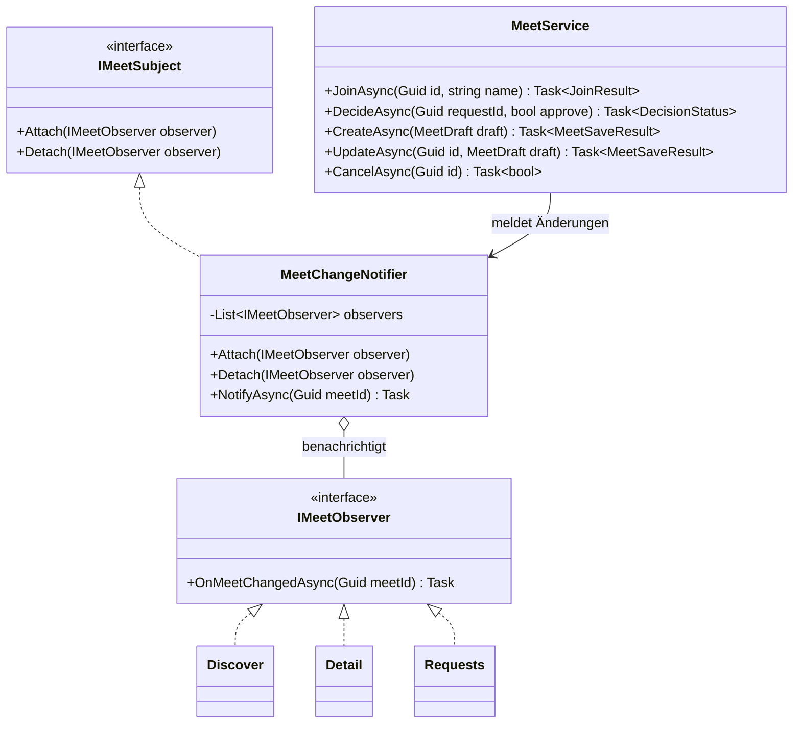
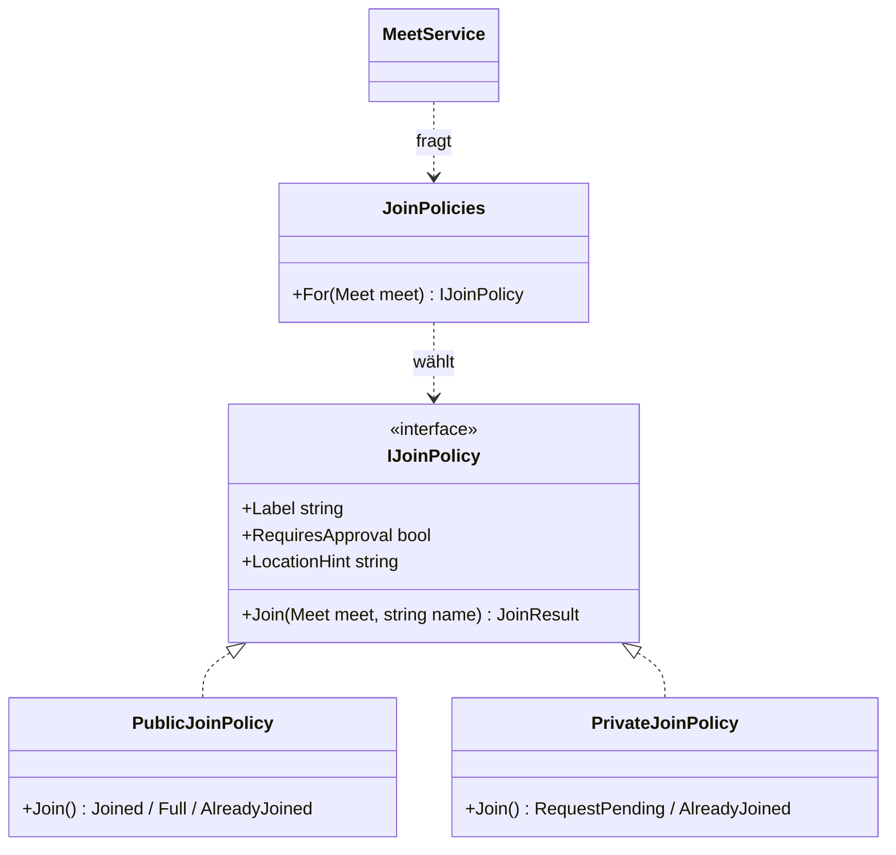
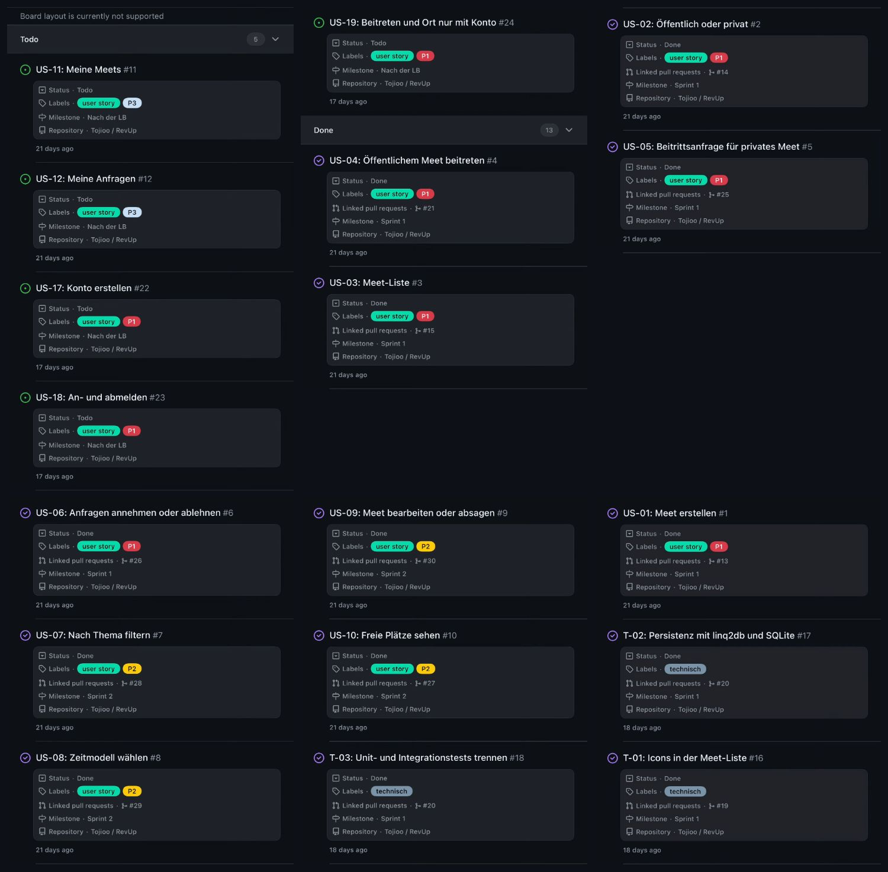

# Lösungsdokument LB 426: RevUp

*Dokument 12 von 12 · [← 11 Prototyp-Test](UX/11-PROTOTYP-TEST.md) · [↑ Start](../README.md)*

| | |
|---|---|
| Name | Nicolas Stadelmann |
| Klasse | IN24a |
| Modul | 426 «Software mit agilen Methoden entwickeln» |
| Projekt | RevUp, Web-App zur Organisation von Car- und Bike-Meets (eigene Idee, Einzelarbeit, von der Lehrperson freigegeben) |
| Repository | https://github.com/Tojioo/RevUp (öffentlich) |
| Board | https://github.com/users/Tojioo/projects/2/views/1 |
| Abgabe | Ordner und ZIP `StadelmannLB-426`, Abgabetermin 02.11.2026 (mit der Lehrperson vereinbart) |

## 0 Administratives (Aufgabe 0-1)

- Einzelarbeit statt Partnerarbeit und GitHub statt GitLab der BBB sind mit der Lehrperson abgesprochen; bewertet wird wie ein Teamprojekt.
- C# mit .NET 10 und ASP.NET Core Blazor, Tests mit xUnit, CI mit GitHub Actions.
- Gemergt wird nur mit Merge Commits (Squash und Rebase ausgeschaltet), Branches werden nicht gelöscht. So bleiben die Test-Commits jeder Story sichtbar.
- Alle schriftlichen Ergebnisse stehen in diesem Dokument. Quellcode und weitere Dokumente liegen im Ordner `RevUp` der Abgabe und im Repository.

## 1 User Stories (Aufgaben 1-1, 1-2)

Jede Story hat das Format «Als \<Rolle> möchte ich \<Ziel>, damit \<Nutzen>», eine eindeutige ID und prüfbare Akzeptanzkriterien und ist ein GitHub-Issue. US-01 bis US-10 sind umgesetzt; US-11, US-12 und die Konten (US-17 bis US-19) folgen nach der LB (siehe [Product Backlog](01-BACKLOG.md)).

| ID | User Story | Akzeptanzkriterien |
|---|---|---|
| US-01 | Als Veranstalter möchte ich ein neues Meet mit Titel, Thema, Ort, Zeitmodus, max. Teilnehmerzahl und max. Lautstärke erstellen, damit ich einen Treffpunkt organisieren kann. | Meet wird gespeichert; alle Pflichtfelder validiert; Meet erscheint in der Übersicht. |
| US-02 | Als Veranstalter möchte ich ein Meet als "Öffentlich" oder "Privat" markieren, damit ich steuern kann, wer den Standort sieht. | Sichtbarkeits-Flag beeinflusst nachgelagerten Beitritts-Flow (US-04/US-05). |
| US-03 | Als Teilnehmer möchte ich alle aktuellen Meets in einer Liste sehen, damit ich ein passendes Meet finden kann. | Liste zeigt Titel, Thema, Zeitfenster, Sichtbarkeit (öffentlich/privat), ohne genauen Standort. |
| US-04 | Als Teilnehmer möchte ich einem öffentlichen Meet mit meinem Namen beitreten und danach sofort den Standort sehen, damit ich hinfahren kann. | Nach Angabe Name + Bestätigung wird Standort angezeigt; Teilnehmerzahl wird erhöht (max. Limit beachten). |
| US-05 | Als Teilnehmer möchte ich bei einem privaten Meet eine Beitrittsanfrage mit meinem Namen stellen, damit der Veranstalter über meine Teilnahme entscheiden kann. | Anfrage landet in Pending-Liste des Veranstalters; Standort ist für den Anfragenden noch nicht sichtbar. |
| US-06 | Als Veranstalter möchte ich offene Beitrittsanfragen zu meinem privaten Meet annehmen oder ablehnen, damit ich die Kontrolle über die Teilnehmerliste behalte. | Bei Annahme wird Standort für die Person sichtbar; bei Ablehnung nicht. |
| US-07 | Als Teilnehmer möchte ich Meets nach Thema filtern (z. B. 90s Cars, Tuning, Motorräder), damit ich schneller passende Meets finde. | Filter reduziert die Liste korrekt; kombinierbar mit Status (öffentlich/privat). |
| US-08 | Als Veranstalter möchte ich ein Zeitmodell wählen (Fixed / Open Start / Open End), damit klar ist, wann das Meet stattfindet. | Zeitmodell wird bei Erstellung gewählt und in der Detailansicht korrekt dargestellt. |
| US-09 | Als Veranstalter möchte ich mein Meet bearbeiten oder absagen, damit ich auf Änderungen reagieren kann. | Änderungen/Absage werden für Teilnehmer sichtbar/nachvollziehbar. |
| US-10 | Als Teilnehmer möchte ich sehen, wie viele Plätze bei einem Meet noch frei sind, damit ich weiss, ob sich eine Anfrage lohnt. | Anzeige "X / max. Teilnehmer" korrekt und live aktualisiert. |

Dazu kamen drei technische Aufgaben: T-01 (Icons), T-02 (Persistenz mit linq2db und SQLite), T-03 (Unit- und Integrationstests getrennt).

## 2 Design Patterns (Aufgabe 2-1)

### 2.1 Observer (vorgegeben)

**Problem:** Mehrere Personen sehen dasselbe Meet gleichzeitig. Der Veranstalter wartet auf Anfragen, die anfragende Person auf den Entscheid, und in «Entdecken» sollen die freien Plätze stimmen (US-10). Ohne Pattern müsste der `MeetService` jede Seite kennen, oder jede Seite müsste ständig neu laden.

**Lösung:** Der `MeetService` meldet jede Änderung einem Subjekt. Seiten melden sich als Beobachter an und laden bei einer Meldung neu. Sender und Empfänger kennen sich nicht.

| Rolle im Pattern     | Klasse im Code                                                |
|----------------------|---------------------------------------------------------------|
| Subjekt (Interface)  | `IMeetSubject` mit `Attach` und `Detach`                      |
| Konkretes Subjekt    | `MeetChangeNotifier`, zusätzlich `NotifyAsync(meetId)`         |
| Beobachter           | `IMeetObserver` mit `OnMeetChangedAsync(meetId)`              |
| Konkrete Beobachter  | Seiten `Discover`, `Detail` und `Requests` (Blazor-Komponenten) |
| Auslöser             | `MeetService` nach Erstellen, Bearbeiten, Absagen, Beitritt, neuer Anfrage und Entscheid |

- Seiten melden sich in `OnInitializedAsync` an und in `Dispose` ab. `NotifyAsync` arbeitet auf einer Kopie der Liste, weil sich ein Beobachter währenddessen abmelden kann.
- Der Service meldet erst nach dem Freigeben seiner Sperre, weil die Detailseite bei einer Meldung den Service wieder aufruft.
- Tests: `MeetChangeNotifierTests` und `MeetDecisionTests`.

### 2.2 Strategy (zweites Pattern)

**Problem:** Öffentliche und private Meets unterscheiden sich beim Beitritt: öffentlich sofort mit Ort, privat erst nach Freigabe. Ohne Pattern stünden dieselben `if (meet.IsPublic)`-Abfragen in Liste, Detailseite und Service, und jede neue Regel (z. B. «nur auf Einladung») müsste überall nachgezogen werden.

**Lösung:** Jede Sichtbarkeit ist eine Strategie mit derselben Schnittstelle. Service, Liste und Detailseite holen sie über `JoinPolicies.For(meet)`.

| Rolle im Pattern     | Klasse im Code                                   |
|----------------------|--------------------------------------------------|
| Strategie (Interface)| `IJoinPolicy` mit `Label`, `RequiresApproval`, `LocationHint`, `Join(meet, name)` |
| Konkrete Strategien  | `PublicJoinPolicy`, `PrivateJoinPolicy`          |
| Auswahl              | `JoinPolicies.For(meet)`                          |
| Kontext              | `MeetService.JoinAsync`, `MeetListItem`, `MeetDetails` |

Tests: `JoinPolicyTests` (Beitritt mit Ort, volles Meet, doppelter Name, privates Meet nie mit Ort).

## 3 Umsetzung (Aufgaben 3-1 bis 3-7)

### 3.1 Anforderungen und Patterns (3-1, 3-5, 3-6)

US-01 bis US-10 sind umgesetzt (Abschnitt 1), Observer und Strategy wie in Abschnitt 2 eingesetzt.

### 3.2 Aufteilung und eigener Branch (3-2)

Einzelarbeit: Die Arbeit ist nach Stories aufgeteilt. Jede Story hat einen eigenen Branch, der per Pull Request in `main` gemergt wird.

### 3.3 Feature-Branches (3-3)

Jeder Branch enthält die ID der Story und wurde in `main` zurückgemergt.

| Branch | Story | Stichworte | Pull Request |
|---|---|---|---|
| `US-01-meet-erstellen` | US-01 | Formular «Neues Meet», serverseitige Validierung, Stepper | #13 |
| `US-02-sichtbarkeit` | US-02 | Umschalter öffentlich/privat, Strategy Teil 1 | #14 |
| `US-03-meet-liste` | US-03 | Liste kommender Meets ohne Standort, Zeitfenster auf Deutsch | #15 |
| `T-01-listen-icons` | T-01 | Icons für Zeit und Ort | #19 |
| `T-02-T-03-persistenz` | T-02, T-03 | SQLite mit linq2db, async Services, Integrationstests mit Snapshot | #20 |
| `US-04-oeffentlich-beitreten` | US-04 | Detailseite, Beitritt, Ort erst nach Beitritt, Strategy Teil 2 | #21 |
| `US-05-beitrittsanfrage` | US-05 | Anfragen speichern, Liste offener Anfragen | #25 |
| `US-06-anfragen-entscheiden` | US-06 | Annehmen/Ablehnen, Observer, Live-Aktualisierung | #26 |
| `US-10-freie-plaetze` | US-10 | «Noch X Plätze frei», live | #27 |
| `US-07-filter` | US-07 | Filter nach Thema, kombinierbar mit öffentlich/privat | #28 |
| `US-08-zeitmodell` | US-08 | Zeitmodus Fixed / Open Start / Open End, Darstellung in Liste und Detail | #29 |
| `US-09-bearbeiten-absagen` | US-09 | Bearbeiten, Absagen mit Bestätigung, gemeinsames Formular, Datenbank-Upgrade | #30 |

### 3.4 TDD (3-4)

Pro Story zuerst ein Test-Commit, der in der CI fehlschlägt (rot), danach die Umsetzung (grün):

| Story | Test-Commit (rot) | Implementierung (grün) |
|---|---|---|
| US-01 | [5c0b06a](https://github.com/Tojioo/RevUp/commit/5c0b06a) · [CI](https://github.com/Tojioo/RevUp/actions/runs/38209080199) | [5003eea](https://github.com/Tojioo/RevUp/commit/5003eea) · [CI](https://github.com/Tojioo/RevUp/actions/runs/38209131005) |
| US-02 | [2a009c0](https://github.com/Tojioo/RevUp/commit/2a009c0) · [CI](https://github.com/Tojioo/RevUp/actions/runs/38687012417) | [e834e6c](https://github.com/Tojioo/RevUp/commit/e834e6c) · [CI](https://github.com/Tojioo/RevUp/actions/runs/38687041705) |
| US-03 | [64994e9](https://github.com/Tojioo/RevUp/commit/64994e9) · [CI](https://github.com/Tojioo/RevUp/actions/runs/38688451287) | [380a97b](https://github.com/Tojioo/RevUp/commit/380a97b) · [CI](https://github.com/Tojioo/RevUp/actions/runs/38688524577) |
| T-02/T-03 | [6b4b063](https://github.com/Tojioo/RevUp/commit/6b4b063) · [CI](https://github.com/Tojioo/RevUp/actions/runs/38705142603) | [d13f40b](https://github.com/Tojioo/RevUp/commit/d13f40b) · [CI](https://github.com/Tojioo/RevUp/actions/runs/38705420725), Refactoring [060bad4](https://github.com/Tojioo/RevUp/commit/060bad4) |
| US-04 | [3005297](https://github.com/Tojioo/RevUp/commit/3005297) · [CI](https://github.com/Tojioo/RevUp/actions/runs/38714248604) | [44dcebb](https://github.com/Tojioo/RevUp/commit/44dcebb) · [CI](https://github.com/Tojioo/RevUp/actions/runs/38714384532) |
| US-05 | [4c244bd](https://github.com/Tojioo/RevUp/commit/4c244bd) · [CI](https://github.com/Tojioo/RevUp/actions/runs/40825261432) | [e13248a](https://github.com/Tojioo/RevUp/commit/e13248a) · [CI](https://github.com/Tojioo/RevUp/actions/runs/40825345599) |
| US-06 | [bf160c6](https://github.com/Tojioo/RevUp/commit/bf160c6) · [CI](https://github.com/Tojioo/RevUp/actions/runs/40825622028) | [a23e1ea](https://github.com/Tojioo/RevUp/commit/a23e1ea) · [CI](https://github.com/Tojioo/RevUp/actions/runs/40825713620) |
| US-10 | [63f055a](https://github.com/Tojioo/RevUp/commit/63f055a) · [CI](https://github.com/Tojioo/RevUp/actions/runs/40884570470) | [93928cf](https://github.com/Tojioo/RevUp/commit/93928cf) · [CI](https://github.com/Tojioo/RevUp/actions/runs/40884612004) |
| US-07 | [f480d72](https://github.com/Tojioo/RevUp/commit/f480d72) · [CI](https://github.com/Tojioo/RevUp/actions/runs/40928175302) | [61c8f58](https://github.com/Tojioo/RevUp/commit/61c8f58) · [CI](https://github.com/Tojioo/RevUp/actions/runs/40928290276) |
| US-08 | [2f79d70](https://github.com/Tojioo/RevUp/commit/2f79d70) · [CI](https://github.com/Tojioo/RevUp/actions/runs/40928780023) | [c9a676d](https://github.com/Tojioo/RevUp/commit/c9a676d) · [CI](https://github.com/Tojioo/RevUp/actions/runs/40928933742) |
| US-09 | [b2a9453](https://github.com/Tojioo/RevUp/commit/b2a9453) · [CI](https://github.com/Tojioo/RevUp/actions/runs/41017333570) | [f9bbb2a](https://github.com/Tojioo/RevUp/commit/f9bbb2a) · [CI](https://github.com/Tojioo/RevUp/actions/runs/41017525641) |

`RevUp.Tests` enthält 84 Unit-Tests ohne I/O (mit eigenen Fakes), `RevUp.IntegrationTests` 9 Tests gegen SQLite, jeder mit einer frischen Kopie einer Snapshot-Datenbank. Alle sind grün.

### 3.5 Coding Conventions und Code Smells (3-7)

- `.editorconfig` und StyleCop in jedem Projekt; der Build läuft ohne Warnungen, die CI prüft das bei jedem Push. Zusätzlich sind die Rider-Inspektionen bereinigt.
- Kommentare nur für das «Warum», z. B. warum der Service erst nach dem Freigeben der Sperre meldet.
- Doppelter Code ist zusammengefasst, z. B. ein gemeinsames Formular (`MeetForm`) für Erstellen und Bearbeiten und die Beispieldaten nur im `MeetSeeder`.

## 4 SOLID-Beurteilung (Aufgabe 4-1)

| Prinzip | Beurteilung mit Beispiel aus dem Code | Verletzung und Verbesserung |
|---|---|---|
| **S** Single Responsibility | Erfüllt bei den meisten Klassen: `MeetDraftValidator` prüft nur Eingaben, `MeetRepository` greift nur auf die Datenbank zu, `MeetChangeNotifier` verteilt nur Meldungen. | **Teilweise verletzt:** `MeetService` liest, steuert Beitritte und Anfragen und bearbeitet und sagt ab. Verbesserung: aufteilen in `MeetQueryService` (lesen), `JoinService` (Beitritt, Anfragen) und `MeetEditService` (erstellen, bearbeiten, absagen). |
| **O** Open/Closed | Erfüllt für Beitrittsregeln: Eine neue Strategie (z. B. «nur auf Einladung») ist eine neue Klasse; Service, Liste und Detailseite bleiben unverändert. Neue Beobachter brauchen keine Änderung am Subjekt. | **Teilweise verletzt:** `JoinPolicies.For` wählt über `meet.IsPublic` (`bool`). Für eine dritte Sichtbarkeit müssten Modell und Auswahl geändert werden. Verbesserung: `Visibility` als Enum mit einer Zuordnung Enum → Strategie. |
| **L** Liskov Substitution | Erfüllt: Beide Strategien sind überall austauschbar, wo `IJoinPolicy` erwartet wird. Die Fakes ersetzen die echten Repositories in den Tests, ohne das Verhalten des Service zu ändern. | Keine Verletzung gefunden. |
| **I** Interface Segregation | Erfüllt bei `IMeetSubject` und `IMeetObserver`: Die Seiten kennen nur das Anmelden, nicht `NotifyAsync`. Die Repositories haben kleine Schnittstellen. | **Teilweise verletzt:** `IMeetService` ist breit, jede Seite nutzt nur einen Teil. Verbesserung: getrennte Schnittstellen passend zur Aufteilung bei S. |
| **D** Dependency Inversion | Erfüllt: `MeetService` hängt von `IMeetRepository`, `IJoinRequestRepository` und `TimeProvider` ab, nicht von SQLite oder der Uhr. Darum laufen die Unit-Tests ohne Datenbank. | **Teilweise verletzt:** `MeetService` nutzt den konkreten `MeetChangeNotifier` und die statischen Klassen `JoinPolicies` und `MeetDraftValidator`. Verbesserung: Schnittstelle `IMeetChangePublisher` und die Strategie-Auswahl als injizierbarer Dienst. |

## 5 Sprint-Reviews

**Sprint 1 (bis 29.10.):** US-01 bis US-06 und T-01 bis T-03 umgesetzt und an der laufenden App durchgespielt. Die neu aufgenommenen Konten (US-17 bis US-19) wurden bewusst nach der LB verschoben.

**Sprint 2 (30.10. – 01.11.):** US-07 bis US-10 umgesetzt (US-07, US-08 und US-10 schon am 29.10. vorgezogen) und an der laufenden App durchgespielt. Beim Bearbeiten bleibt die Sichtbarkeit bewusst fix, weil sich Teilnehmende danach gerichtet haben. Offen bleiben US-11, US-12 und US-17 bis US-19.

## 6 Retrospektive (Aufgaben 5-1, 5-2)

Rückblick auf beide Sprints mit der Frage «Was hat meine Arbeitsweise gebremst?», bezogen auf Planung, Praktiken und Zusammenarbeit, nicht auf das Produkt.

| # | Hindernis (Impediment) | Auswirkung | Lösung (für mich umsetzbar) |
|---|---|---|---|
| 1 | **Eine Woche Ausfall (21.–27.10.)** ohne Puffer in der Planung. | Beide Sprints rückten an den Abgabetermin, Stories mussten verschoben werden. | Bewertungsrelevantes zuerst einplanen und pro Sprint etwa 20 % Puffer freihalten. Abwesenheiten sofort der Lehrperson melden. |
| 2 | **Neue Anforderungen mitten im Sprint** (Konten, Vorgaben zu Persistenz und Testaufbau). | Der Plan änderte sich mehrmals, technische Aufgaben verdrängten Stories. | Neue Wünsche zuerst nur ins Product Backlog schreiben und erst im nächsten Sprint Planning priorisieren. Die Definition of Ready gilt auch für technische Aufgaben. |
| 3 | **Kontextwechsel zwischen zwei Projekten** und uneinheitliche Prüfungen: Das Vorgehen wurde anfangs im falschen Projekt aufgesetzt, und Rider zeigte Hinweise, die die CI nicht prüft. | Zeitverlust durch Rückbau; Hinweise fielen erst nach dem Merge auf. | Ein Projekt pro Arbeitssitzung und das Board als einzige Quelle für «Was ist dran?». Vor dem Pull Request dieselben Prüfungen wie die CI und die Rider-Inspektion laufen lassen. |

Erkenntnis: Kleine Stories mit Test zuerst haben sich bewährt. Weil jede Story fertig und gemergt war, blieb der Rückstand nach dem Ausfall überschaubar.

## 7 Einsatz von KI

### 7.1 Werkzeug und Umfang

Ich habe in diesem Projekt KI in mehreren Bereichen eingesetzt. Bei neuen Features habe ich damit Ideen gesammelt und Lösungsansätze besprochen. Die in die IDE integrierte KI habe ich während der ganzen Entwicklung verwendet, so wie auch in meinem normalen Arbeitsalltag: für kurze Fragen, Refactorings, das Debuggen von Tests und teilweise auch, um Code vollständig schreiben zu lassen, wenn das schneller ging. Vor dem Committen habe ich meine Änderungen von der KI prüfen lassen, um Fehler und Unklarheiten früh zu finden.

Ab Mitte Oktober hat Claude Code nach meinen Vorgaben einen grossen Teil der Umsetzung übernommen, also Code und Tests der Stories. Nach meinem einwöchigen Ausfall war das nötig, damit ich das Projekt rechtzeitig abgeben konnte. Auch dieses Lösungsdokument hat Claude Code in meinem Auftrag entworfen; diesen Abschnitt habe ich selbst geschrieben und von Claude Code auf Genauigkeit prüfen lassen.

Ausserdem hat mir die KI bei der Verwaltung des Repositorys geholfen, also beim Einrichten der CI-Pipeline und beim Erstellen von Issues und Pull Requests, und mir erklärt, wie ich das Board einrichte. Bei Soloprojekten arbeite ich normalerweise nur mit einem Main- und einem Dev-Branch, und mit Stories, Pull Requests und ähnlichem kenne ich mich vor allem in Azure DevOps aus. Da mir der Ablauf auf GitHub weniger vertraut ist, habe ich diesen Teil bewusst der KI überlassen.

### 7.2 Meine Rolle

Die Idee, die Anforderungen und die Grundzüge der Architektur (Blazor, Persistenz mit linq2db und SQLite, Aufbau der Tests) stammen von mir. Ich habe die Entwicklung selbst gesteuert und entschieden, wann ich Code selbst schreibe und wann ich die KI einsetze. Auch bei Claude Code habe ich vorgegeben, was umgesetzt wird und in welcher Reihenfolge. Aus den Vorschlägen beim Brainstorming habe ich ausgewählt, was ich umsetze und was nicht. Welche Issues es gibt, wie sie priorisiert werden und wann etwas gemergt wird, habe ich selbst festgelegt, und das Board habe ich selbst gepflegt.

### 7.3 Kontrolle

Code und Vorschläge der KI habe ich nie ungeprüft übernommen. Alles, was die KI in der IDE geschrieben oder umgebaut hat, habe ich gelesen, bei Bedarf angepasst und getestet, bevor es in einen Commit kam. Die Änderungen von Claude Code kamen als Pull Requests, die ich durchgesehen und selbst gemergt habe. Die Einschätzungen zu meinen Commits habe ich als zweite Meinung genutzt, entschieden habe ich selbst. Issues und Pull Requests, welche die KI vorbereitet hat, habe ich durchgesehen und bei Bedarf korrigiert.

### 7.4 Fazit

Die KI war für mich ein alltägliches Werkzeug, das mir vor allem bei Routinearbeiten, beim Debuggen, bei der Umsetzung der Stories und bei der Organisation des Repositorys viel Zeit gespart hat. Beim Brainstorming und beim Prüfen der Commits war sie eine hilfreiche zweite Meinung. Nach meinem Ausfall hat mir Claude Code ermöglicht, den Abgabetermin trotzdem einzuhalten. Ihre Vorschläge passten aber nicht immer zum Projekt und mussten geprüft werden. Weil ich jede Änderung selbst kontrolliert habe, behielt ich den Überblick und die Verantwortung für den Code. Die wichtigsten Anfragen stehen im [KI-Protokoll](02-KI-PROTOKOLL.md).